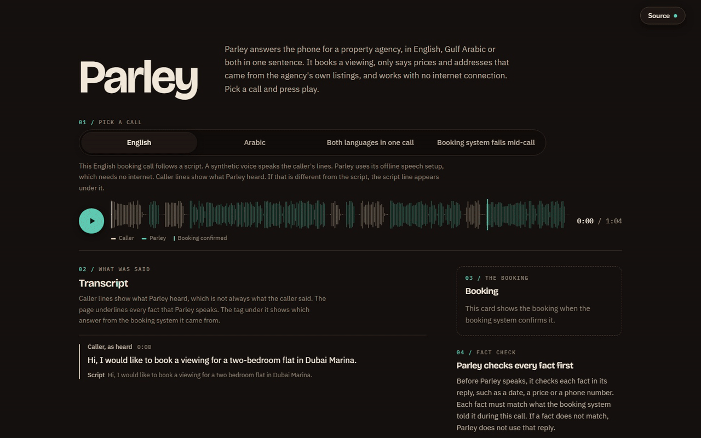
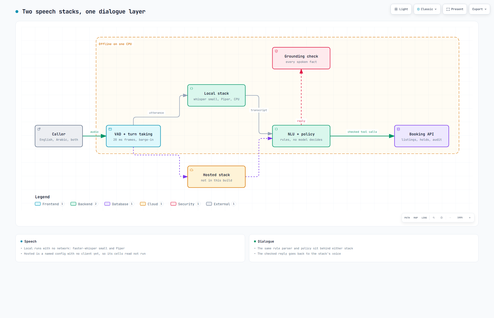
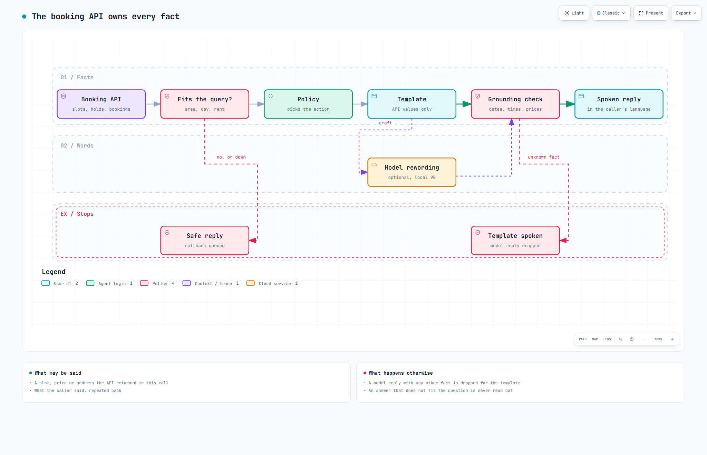
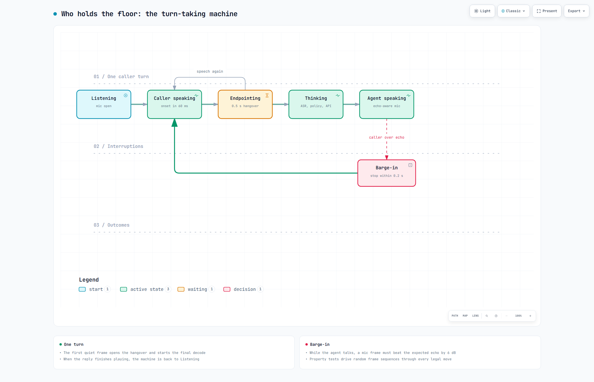
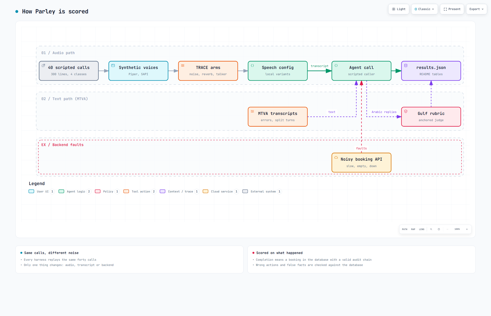

# Parley

Parley answers the phone for a property agency in English, Gulf Arabic or both in one sentence. It books a viewing. It only says prices and addresses that came from the listings database. It works with no internet connection.

**Demo:** [samad-zeeshan.github.io/Parley](https://samad-zeeshan.github.io/Parley/) plays recorded calls in English, in Arabic and in a mix of both. In one more call, the booking system fails in the middle of the call. The page marks each fact that Parley speaks with the booking system call that it came from. A longer video is in [docs/demo.mp4](docs/demo.mp4).



## How it works

Each speech setup sends text to the same rule parser, policy and booking system.


Parley checks each fact in a reply, such as a date or a price, against the booking system answers in this call.


A small state machine decides who speaks, so Parley stops when a caller interrupts.


The tests play the same scripted calls again with noise in the audio, errors in the transcripts and a booking system that fails.

## Design decisions
- The offline setup `local` uses faster-whisper small and Piper on one CPU. A customer can run it today with no network and no fee per minute. The cloud setup `hosted` has a column in every table. It has no client or credentials yet, so its cells say "not run".
- No model decides the next step or chooses a booking detail. Replies come from fixed templates. A model on the same computer can reword a reply. If a reworded reply holds a fact that the booking system did not give, Parley drops it.
- If the booking system is slow, down or gives answers that do not agree, Parley says that it cannot confirm. It does not claim that the booking worked or failed. It arranges a call back.
- Sometimes a caller turn arrives as two messages. Parley joins them before it reads the turn. This change fixed split turns, but results got a little worse when transcripts had many errors. The tables show both results.
- The first speech prompt stays the default. The prompt for both languages, "mixed prompt" in the tables, keeps English words correct. But it loses Arabic words.

## Results
The tests use scripted calls on one laptop CPU. The calls are in English, in Arabic or in both languages. The Arabic calls use Gulf Arabic or Modern Standard Arabic (MSA). A call in both languages mixes Gulf Arabic and English. All caller voices are synthetic. The only offline Arabic voice is Jordanian, so the Gulf rows test Gulf words, not a Gulf accent.

The tests use no real dialect audio. The project found no public release of Bulbul, and the NADI 2026 sets state no licence. The tables come from `eval/results.json`, and the first-version figures come from `eval/results_v1.json`. CI fails if the tables and the files do not match.

<!-- results:begin -->
This table counts the calls that the scripted callers booked with the rule parser.

| calls booked | first version (8 calls) | offline | offline, fuzzy parser | mixed prompt | two-pass decode | cloud |
|---|---|---|---|---|---|---|
| English | 2/2 | 6/10 | 8/10 | 7/10 | 7/10 | not run |
| Gulf Arabic | 2/2 | 8/10 | 8/10 | 4/10 | 3/10 | not run |
| MSA | 1/2 | 3/10 | 4/10 | 1/10 | 1/10 | not run |
| Both languages | 0/2 | 0/10 | 0/10 | 0/10 | 1/10 | not run |
| All | 5/8 | 17/40 | 20/40 | 12/40 | 12/40 | not run |
| Wrong actions | n/a | 5 | 6 | 5 | 3 | not run |
| Replies with a fact not from the booking system | 0 | 0 | 0 | 0 | 0 | not run |

On lines with both languages, each language gets its own score, as in arXiv 2605.19069. Word error rate on the English words, lower is better: offline 0.500, mixed prompt 0.237, two-pass decode 0.108, cloud not run. Word error rate on the Arabic words, lower is better: offline 0.695, mixed prompt 0.808, two-pass decode 0.350, cloud not run. Share of English words kept in Latin script, higher is better: offline 0.552, mixed prompt 0.861, two-pass decode 0.990, cloud not run.

This table tests the dialogue layer alone on the same calls, as in MTVA (arXiv 2609.20152).

| transcript | transcript word error rate | rules intent | rules slot F1 | rules booked | rules, no carry-over booked | Jev intent | Jev booked | 9B intent | 9B booked | reply language kept |
|---|---|---|---|---|---|---|---|---|---|---|
| reference text | 0.000 | 0.895 | 0.977 | 38/40 | 38/40 | 0.642 | 27/40 | 0.794 | 36/40 | 1.000 |
| offline recognizer text | 0.390 | 0.642 | 0.623 | 17/40 | 18/40 | 0.693 | 14/40 | 0.574 | 13/40 | 0.906 |
| cloud recognizer text | not run | not run | not run | not run | not run | not run | not run | not run | not run | not run |
| 5% injected errors | 0.050 | 0.800 | 0.891 | 34/40 | 35/40 | not run | not run | not run | not run | 0.991 |
| 10% injected errors | 0.097 | 0.724 | 0.807 | 34/40 | 34/40 | 0.609 | 25/40 | 0.668 | 34/40 | 0.982 |
| 20% injected errors | 0.202 | 0.534 | 0.620 | 21/40 | 25/40 | not run | not run | not run | not run | 0.980 |
| 30% injected errors | 0.293 | 0.425 | 0.509 | 9/40 | 9/40 | 0.506 | 5/40 | 0.435 | 9/40 | 0.978 |
| split turns | 0.000 | 0.867 | 0.859 | 29/40 | 0/40 | 0.646 | 20/40 | 0.768 | 29/40 | 0.945 |

On the reference text, Parley spoke 265 replies that the 9B model reworded. The fact check rejected 51 reworded replies. The share of replies in the language of the caller was 1.000. Spoken replies with a fact not from the booking system: 0. On the offline recognizer text, Parley spoke 454 replies that the 9B model reworded. The fact check rejected 70 reworded replies. The share of replies in the language of the caller was 0.905. Spoken replies with a fact not from the booking system: 0.

This table adds noise to the caller audio on the offline setup, as in TRACE (arXiv 2609.29452). The plot is in `eval/trace.svg`.

| noise (offline) | English | Gulf Arabic | MSA | Both languages | wrong actions | recovered after trouble | extra turns | cloud |
|---|---|---|---|---|---|---|---|---|
| clean | 6/10 | 8/10 | 3/10 | 0/10 | 5 | 14/37 | 0.0 | not run |
| white@20 | 7/10 | 5/10 | 4/10 | 0/10 | 6 | 13/37 | 1.4 | not run |
| white@10 | 6/10 | 2/10 | 3/10 | 0/10 | 7 | 7/36 | -2.6 | not run |
| white@5 | 7/10 | 0/10 | 4/10 | 0/10 | 9 | 8/37 | 0.9 | not run |
| babble@20 | 6/10 | 6/10 | 6/10 | 0/10 | 4 | 14/36 | 0.1 | not run |
| babble@10 | 6/10 | 5/10 | 3/10 | 0/10 | 3 | 11/37 | -0.7 | not run |
| babble@5 | 6/10 | 0/10 | 4/10 | 0/10 | 7 | 7/37 | 0.2 | not run |
| reverb@0.3 | 7/10 | 6/10 | 1/10 | 0/10 | 11 | 11/37 | -1.6 | not run |
| reverb@0.8 | 6/10 | 2/10 | 2/10 | 0/10 | 6 | 8/38 | -0.8 | not run |
| competing | 6/10 | 3/10 | 3/10 | 0/10 | 13 | 10/38 | 0.2 | not run |

This table shows how long Parley took to reply on the development CPU, for all turns. The target is 1.5 s. The clock starts when the 0.5 s pause of the caller ends the turn. Early decode starts recognition on the first quiet frame.

| speech setup | booked | half within (s) `p50` | 19 in 20 within (s) `p95` | 19 in 20 within, no early decode (s) |
|---|---|---|---|---|
| first version (whisper small) | 5/8 | 2.38 | n/a | 4.17 |
| offline (whisper small) | 17/40 | 1.78 | 4.26 | 4.76 |
| mixed prompt | 12/40 | 1.55 | 3.82 | 4.32 |
| two-pass decode | 12/40 | 1.82 | 4.74 | 5.24 |
| whisper base | 7/40 | 0.33 | 1.44 | 1.94 |
| whisper tiny | 6/40 | 0.16 | 1.22 | 1.68 |
| cloud | not run | not run | not run | not run |

The tests made the booking system fail in 6 ways, on the reference text (arXiv 2608.02372, 2606.31307). Calls booked with no failure and per failure: clean 38/40, slow 9/40, empty 0/40, contradictory 0/40, contradictory-confirm 38/40, down 0/40, down-at-confirm 0/40. Parley spoke 0 false facts in all of these runs. Of the calls that hit a failure, Parley handled 232/232 safely. It arranged 78 call backs. Cloud: not run.

A Gulf dialect rubric (arXiv 2608.29990) gave each reply a calibrated score out of 1. The fixed replies of Parley scored 0.917 over 19 replies. The replies that the 9B model reworded scored 0.679 over 40 replies. The reworded replies lost points for register flattening 24, wrong dialect 22, hallucination 10, ambiguous framing 3. The judge model qwen/qwen3.6-35b-a3b agreed with 13 labelled examples on 0.815 of the criteria. No native speaker checked the scores yet.

When a caller interrupted, Parley stopped within 0.2 s in these cases: English 77/82, Gulf 117/121, MSA 132/139, both languages 136/146. The first version scored English 5/6, Gulf 10/11, MSA 17/18, both languages 22/22. The slowest stop took 0.40 s. Parley stopped 0 times because of the echo of its own voice.
<!-- results:end -->

The fact check held in every run and in every booking system failure. Parley never spoke a fact that the booking system did not give. Many Arabic calls and nearly all calls in both languages still fail because speech recognition gets words wrong. The one success in both languages depends on the pauses that a synthetic caller leaves between languages. No offline setup is both fast and accurate. Only the small Whisper models meet the target for reply time, and they book the fewest calls.

Noise hurts Gulf Arabic calls the most. A second person who talks in the background causes the most wrong actions. On calls in both languages, Parley stopped on time less often than the first version, but the new sample is far larger. No native speaker checked the rubric judge yet, so its scores are only a rough guide.

## Run it
```
uv sync && uv run pytest                                          # hermetic suite, no models needed
uv run --extra speech python -m eval.run_eval --speech local-v1   # the scripted calls on the local stack
uv run --extra speech uvicorn api.server:app --port 8000          # push-to-talk page at 127.0.0.1:8000
```

## Papers
- Evaluation: arXiv 2609.20152 (MTVA-Bench), 2609.29452 (acoustic stress, TRACE), 2605.19069 (speech recognition for mixed languages), 2609.21084 (digit error rates)
- Dialect and judges: arXiv 2608.29990 (Saudi dialect rubric), 2609.29431 (calibration of LLM judges), 2605.16364 (WASIL, real Arabic speech turns)
- Failures and turn taking: arXiv 2608.02372 (PredAct-Bench), 2606.31307 (safe recovery when the database fails), 2609.03321 (finite-state turn taking)
- Models and data: arXiv 2609.23959, 2609.26550 (Jev decisions), 2609.25176, 2609.11892, 2609.27086, 2609.24410, 2609.03423, 2609.23955, 2608.21950, 2604.14186

## Licence
MIT.
